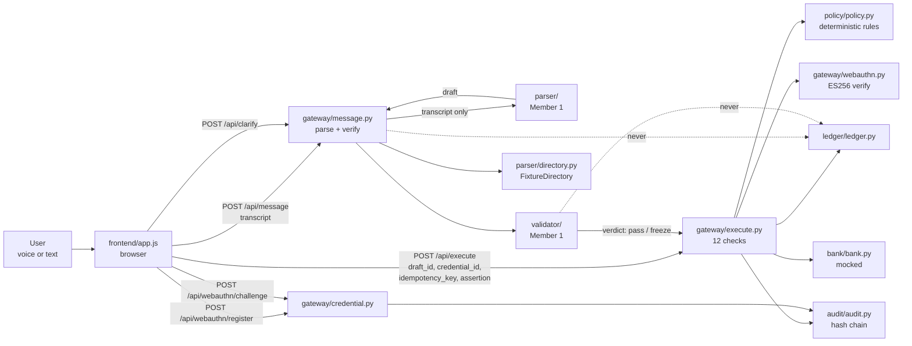
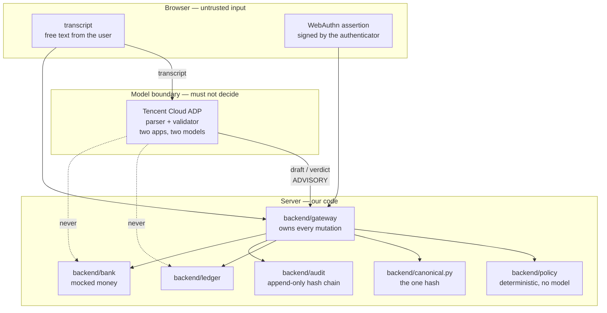

# Architecture

How a sentence becomes a posted transaction, and where the boundaries are.

The short version: **the AI writes a draft, and only a signature writes to the
ledger.** Everything in this repo exists to keep those two facts separated by
something the AI cannot cross.

## The flow

The dashed lines are the ones that matter. The parser and the validator can
read a draft and can refuse one; neither has a reference to the ledger, the
bank, or `/api/execute`. That is enforced by what they are constructed with,
not by a comment.

## Trust boundaries

### What crosses each boundary

| Boundary | Crosses | Never crosses |
|---|---|---|
| Browser → server | transcript, `draft_id`, `credential_id`, `idempotency_key`, `assertion` | a draft. The frontend never builds one (CONTRACT.md §2) |
| Server → model | the transcript, and a draft to be checked | anything the server will trust |
| Model → server | a draft, or a `pass`/`freeze` verdict with discrepancies | a decision. `pass` is necessary, not sufficient |
| Server → ledger | one row, after all 12 checks | anything else, ever |

### Why the model is on the far side

The parser is asked to turn "send fifty to John" into structured fields. It
can be wrong, and it can be talked into being wrong. So its output is a
*draft* — data — and three things stand between a draft and money:

1. **Validator** (a second model, a second ADP app, a different model label):
   re-reads the draft against the transcript and returns `pass` or `freeze`.
   Check 11.
2. **Policy** (`backend/policy/policy.py`): pure deterministic rules over
   numbers — no model, no network. Check 12.
3. **Signature**: ES256 over a challenge bound to the exact bytes of the
   draft. Checks 6–10. Even a draft that passes 11 and 12 does not post
   until a private key it cannot reach signs it.

If the validator or the parser is compromised, the worst outcome is a draft
the gateway refuses. Neither can post.

### The hash is the binding

`backend/canonical.py` produces one canonical hash of a draft, in one place.
The challenge the authenticator signs is derived from it, and checks 8
recompute it from the *stored* draft. So a draft edited after the user agreed
to it — anywhere, by anyone — makes the signature stop verifying. That is
what makes "the AI cannot move money" a property of the code rather than a
promise in a comment.

## Module map

| Module | Owns | Notes |
|---|---|---|
| `backend/gateway/api.py` | `GatewayAPI`, the 12-check ordering | the only object that holds every dependency |
| `backend/gateway/message.py` | `/api/message`, `/api/clarify` | parsing, clarification, verdict binding |
| `backend/gateway/credential.py` | `/api/webauthn/register`, `/challenge` | refuses a challenge without a recorded `pass` |
| `backend/gateway/execute.py` | `/api/execute`, checks 1–12 | the only path to the ledger |
| `backend/gateway/webauthn.py` | ES256 verification, key coercion | P-256 only |
| `backend/canonical.py` | the draft hash | one implementation, used by both sides |
| `backend/policy/policy.py` | `allow` / `step_up` / `hold` / `block` | deterministic; no model |
| `backend/ledger`, `backend/audit` | posted rows, append-only chain | audit is verifiable via `/api/audit/verify` |
| `backend/bank` | accounts, balances, transfers | **mocked**; no real money anywhere |
| `backend/parser`, `backend/validator` | the AI layer | Member 1 |

## Deployment

`rp_id` and the expected origin are read from `DCTA_RP_ID` and
`DCTA_ORIGIN` (defaults `localhost` and `http://localhost:8000`). WebAuthn
is bound to a host, so a deployment that does not set these will fail every
signature with `signature_invalid` — which looks like a broken authenticator
and is actually a wrong config. See the environment table in `README.md`.
